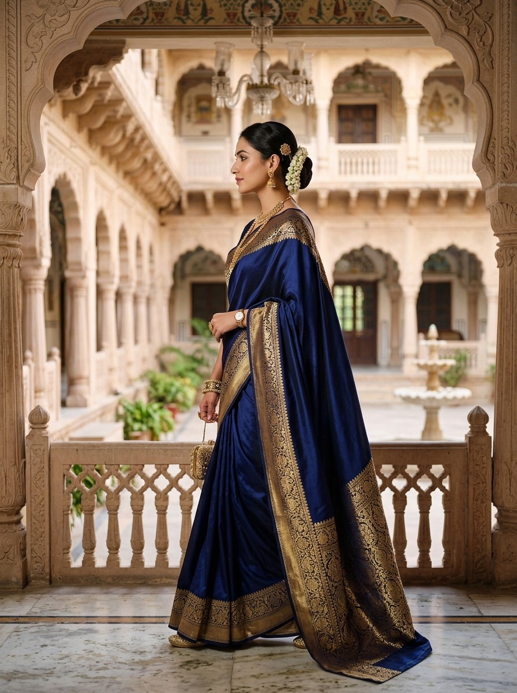
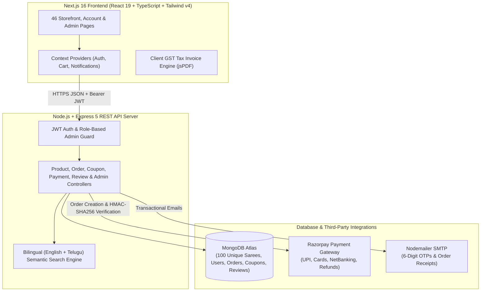
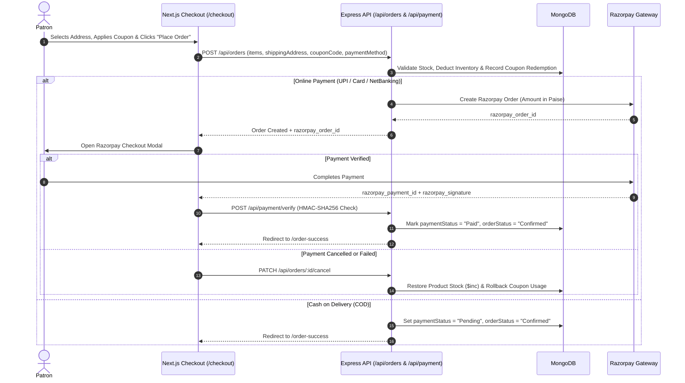

<div align="center">


# SilkVerse — Luxury Handloom & Pure Silk Saree E-Commerce Platform

***"Elegance Woven Into Every Thread — From the Royal Looms of Dharmavaram, Kanchipuram, Banaras, Paithan & Gadwal."***

[](https://github.com/Vishnu-Sai-bit/SilkVerse/actions)
[](https://nextjs.org/)
[](https://react.dev/)
[](https://www.typescriptlang.org/)
[](https://tailwindcss.com/)
[](https://nodejs.org/)
[](https://www.mongodb.com/)
[](#3-curated-100-saree-catalog--visual-showcase)

</div>

---

## Table of Contents

1. [Executive Summary & Project Vision](#1-executive-summary--project-vision)
2. [Key Highlights & Luxury Experience](#2-key-highlights--luxury-experience)
3. [Curated 100-Saree Catalog & Visual Showcase](#3-curated-100-saree-catalog--visual-showcase)
4. [System Architecture & Execution Workflows](#4-system-architecture--execution-workflows)
5. [Complete Feature Breakdown](#5-complete-feature-breakdown)
6. [Responsive Design Matrix (Mobile, Tablet, Laptop, Desktop)](#6-responsive-design-matrix-mobile-tablet-laptop-desktop)
7. [Technology Stack & Dependencies](#7-technology-stack--dependencies)
8. [Database Schema Specifications](#8-database-schema-specifications)
9. [REST API Reference](#9-rest-api-reference)
10. [Luxury Design System Tokens](#10-luxury-design-system-tokens)
11. [Local Installation & Quick Start](#11-local-installation--quick-start)

---

## 1. Executive Summary & Project Vision

**SilkVerse** is a full-stack Direct-to-Consumer (D2C) luxury e-commerce marketplace connecting master handloom weavers from India's most celebrated weaving clusters (**Dharmavaram, Kanchipuram, Banaras, Yeola Paithan, Gadwal, Venkatagiri, Pochampally, Uppada, and Mysore**) directly with discerning patrons worldwide.

### Core Objectives
- **100% Unique & Authentic Catalog:** 100 individually curated, **Silk Mark India Certified** sarees—every single product features a **100% unique title**, **100% unique 3:4 editorial studio portrait**, single primary color metadata, and transparent artisan weave specifications.
- **Cinematic First Impression:** Features a custom **Royal Silk Curtain Opening Animation** with 3D crimson-brocade velvet folds, a golden *gopuram* pelmet, swinging brass temple bells (*Ganta*), floating 24K gold dust particles, and an interactive **Royal Wax Seal**.
- **Frictionless Shopping & Multi-Step Checkout:** Live promotional coupon picker (`WELCOME10`, `BRIDAL15`, `FESTIVE20`), real-time `5% GST` and shipping calculation (`Free at ₹1,000+`), item thumbnails in checkout summary, **Cash on Delivery (COD)**, and **Razorpay** (`UPI`, `Cards`, `NetBanking`).
- **Complete Connoisseur Account & Admin Console:** Dynamic **Silk Rewards** loyalty points ledger, order tracking with **printable GST tax invoices (`jsPDF`)**, return management, and a full **Admin Command Center**.

---

## 2. Key Highlights & Luxury Experience

| Pillar | Implementation Highlights |
| :--- | :--- |
| **Royal Silk Curtain Intro** | Interactive 3D velvet pleats, golden temple pelmet, swinging temple bells, shimmering zari thread lines, and a one-click royal wax seal (`SilkCurtainIntro.tsx`). |
| **100 Unique Studio Portraits** | 100 distinct 3:4 editorial photographs across **Bridal Silk**, **Pure Silk**, **Handloom Silk**, **Festive Silk**, **Soft Silk**, and **Luxury Silk** (`0` duplicates). |
| **Bilingual Semantic Search** | Supports English and Telugu (`పెళ్లి`, `వధువు`, `కంచి`, `ధర్మవరం`, `బంగారు`) natural-language search queries alongside price, category, fabric, weave, and rating filters. |
| **Clean Single-Portrait PDP** |Focused 3:4 portrait frame without distracting multi-angle clutter, paired with artisan weave specifications, Silk Mark certification badge, and verified buyer reviews. |
| **Checkout with Live Coupons** | 3-step checkout (`Address → Payment → Review`) displaying product thumbnails, interactive coupon drawer with instant discount calculation, and Razorpay/COD support. |
| **Dynamic Silk Rewards** | Calculates real loyalty points (`Silver → Gold → Royal Connoisseur`) directly from customer orders, verified reviews, and voucher redemptions. |

---

## 3. Curated 100-Saree Catalog & Visual Showcase

Every saree in **SilkVerse** is photographed in a dedicated 3:4 vertical portrait showcasing the drape, pallu (*kongu*), and temple zari border.

### A. Royal Bridal & Muhurtham Silk Collection (`Bridal Silk`)
Heirloom *Muhurtham* pattu sarees woven with 3-ply mulberry silk and heavy 24K gold-dipped silver zari brocade.

| Sindoor Red Dharmavaram Bridal | Emerald Korvai Muhurtham | Amethyst Peacock Brocade | Swarna Gold Tissue Bridal |
| :---: | :---: | :---: | :---: |
|  |  |  |  |
| **₹29,500** • *Dharmavaram* | **₹31,200** • *Kanchipuram* | **₹27,800** • *Dharmavaram* | **₹34,500** • *Kanchipuram* |

| Rani Gopuram Bridal Silk | Kumkum Floral Jaal Bridal | Peacock Blue Temple Bridal | Banarasi Wine Jangla Bridal |
| :---: | :---: | :---: | :---: |
|  |  |  |  |
| **₹28,400** • *Kanchipuram* | **₹30,900** • *Kanchipuram* | **₹26,500** • *Kanchipuram* | **₹32,000** • *Banarasi Katan* |

---

### B. Heritage Handloom & Pure Silk Collection (`Pure Silk` & `Handloom Silk`)
Masterpieces from Kanchipuram, Gadwal, Yeola Paithan, Pochampally, and Venkatagiri with interlocking *Korvai* and *Kuttu* borders.

| Kanchipuram Emerald Korvai | Gadwal Turmeric Kuttu Border | Yeola Paithani Crimson Muniya | Dharmavaram Sapphire Courtyard |
| :---: | :---: | :---: | :---: |
|  |  |  |  |
| **₹19,800** • *Korvai Weave* | **₹16,400** • *Gadwal Kuttu* | **₹24,500** • *Yeola Paithani* | **₹21,200** • *Dharmavaram* |

| Pochampally Wine Double Ikat | Venkatagiri Sapphire Coin | Kanchipuram Jamun Temple | Mysore Burgundy Kasuti Crepe |
| :---: | :---: | :---: | :---: |
|  |  |  |  |
| **₹18,500** • *Telia Ikat* | **₹15,900** • *Venkatagiri* | **₹22,400** • *Kanchipuram* | **₹17,200** • *Mysore Crepe* |

---

### C. Festive & Featherlight Soft Silk Collection (`Festive Silk` & `Soft Silk`)
Breathable pastel and jewel-toned Uppada Jamdani, Mysore Crepe, and Soft Pattu sarees crafted for effortless celebratory draping.

| Paithani Emerald Peacock | Gadwal Haldi Marigold | Uppada Mint Jamdani Soft Silk | Pearl Ivory Burnished Gold |
| :---: | :---: | :---: | :---: |
|  |  |  |  |
| **₹23,800** • *Festive Silk* | **₹17,500** • *Festive Silk* | **₹14,800** • *Uppada Jamdani* | **₹16,900** • *Soft Silk* |

| Kanchipuram Peacock Vaira Oosi | Pistachio Mint Champagne Zari | Periwinkle Ice Soft Silk | Flamingo Coral Party Soft Silk |
| :---: | :---: | :---: | :---: |
|  |  |  |  |
| **₹20,500** • *Vaira Oosi Checks* | **₹13,900** • *Soft Silk* | **₹14,200** • *Soft Silk* | **₹15,400** • *Soft Silk* |

---

### D. Collector's Edition Luxury Silk (`Luxury Silk`)
Museum-grade collector weaves featuring dense *Jangla* brocade, *Meenakari* motifs, and pure 24K gold tissue.

| Mayuri Emerald Collector Korvai | Bordeaux Wine Banarasi Jangla | Swarna Gold Tissue Couture | Centenary Jade Emerald Korvai |
| :---: | :---: | :---: | :---: |
|  |  |  |  |
| **₹36,800** • *Collector Edition* | **₹38,500** • *Banarasi Jangla* | **₹42,000** • *24K Gold Tissue* | **₹45,000** • *Centenary Edition* |

---

## 4. System Architecture & Execution Workflows

### 4.1 High-Level System Architecture



### 4.2 Checkout, Payment & Automatic Stock Restoration Pipeline



---

## 5. Complete Feature Breakdown

### 5.1 Storefront & Product Discovery
- **Royal Silk Curtain Intro (`components/common/SilkCurtainIntro.tsx`):**
  - 8-pleat 3D crimson-velvet drapes with gold zari borders, ornate temple *gopuram* pelmet, swinging brass bells (*Ganta*), and an interactive royal wax seal.
  - Plays once per session and includes an instant `"Skip Intro"` control and `prefers-reduced-motion` accessibility support.
- **Smart Bilingual Search & Filtering (`app/products/page.tsx`, `app/collections/page.tsx`):**
  - Search by weave, color, occasion, price ceiling (e.g., *"bridal sarees under 25000"*), or Telugu keywords (`పెళ్లి`, `వధువు`, `కంచి`, `ధర్మవరం`).
  - Filter by Category, Occasion, Fabric, Price Range, Color Shade, and Customer Rating.
- **Product Detail Page (`app/products/[id]/page.tsx`):**
  - Clean single-portrait 3:4 display with Silk Mark badge, stock status indicator (`In Stock`, `Only a few left`, `Out of Stock` — exact counts stay private to Admin), accordion specifications, verified customer reviews, and *"You May Also Like"* recommendations.

### 5.2 Cart, Multi-Step Checkout & GST Invoices
- **User-Scoped Shopping Bag (`context/CartContext.tsx`):**
  - Scoped to `silkverse-cart-${userId}` so each customer's bag is preserved across sessions.
  - Real-time calculation of Subtotal, `5% GST`, and Shipping (`Free at ₹1,000+`, `₹100` below `₹1,000`).
- **3-Step Checkout (`app/checkout/page.tsx`):**
  - **Step 1 (Delivery Address):** Choose a saved address or add a new one inline.
  - **Step 2 (Payment Method):** Choose between UPI, Credit/Debit Card, NetBanking, or Cash on Delivery (COD).
  - **Step 3 (Order Review):** Inspect every saree thumbnail, quantity, delivery address, and applied coupon before placing the order.
  - **Interactive Coupon Drawer:** View active store coupons (`/api/coupons/active`), apply with one click, and see instant discount savings in the sticky Order Summary.
- **Printable GST Tax Invoice (`app/orders/[id]/invoice/page.tsx`):**
  - Formatted tax invoice with HSN code (`50072090`), itemized GST breakdown, and one-click print/PDF download.

### 5.3 Customer Connoisseur Account Portal (`/account/*`)
- **Account Overview (`/account`):** Live KPI cards, recent orders with thumbnails, and quick profile summary.
- **Orders & Tracking (`/account/orders`):** Full order timeline (`Pending → Confirmed → Shipped → Delivered`), invoice links, and self-service cancellation for unshipped orders.
- **Silk Rewards (`/account/rewards`):** Dynamic loyalty points calculated from real MongoDB orders, published reviews, and welcome bonuses, with tier progression (`Silver → Gold → Royal Connoisseur`) and voucher redemption.
- **Returns & Exchanges (`/account/returns`):** Submit return or exchange requests tied to real customer orders with 7-day Silk Mark assurance.
- **Saved Payment Methods (`/account/payments`):** Manage saved cards and verified UPI handles locally without pre-populated fake data.
- **Addresses, Wishlist, Reviews & Security (`/account/addresses`, `/account/wishlist`, `/account/reviews`, `/account/security`):** Full self-service management.

### 5.4 Admin Command Center (`/admin/*`)
- **Executive Dashboard (`/admin`):** Total revenue, order counts, fulfillment pipeline breakdown, and low-stock alerts.
- **Product Catalog Manager (`/admin/products`, `/admin/products/new`, `/admin/products/[id]`):** Create, edit, and delete sarees, manage stock counts, and upload product imagery.
- **Order Fulfillment (`/admin/orders`, `/admin/orders/[id]`):** Filter orders, inspect customer shipping details, and update fulfillment status (`Confirmed`, `Shipped`, `Delivered`, `Cancelled`).
- **Promotional Coupons (`/admin/coupons`):** Create percentage or flat-discount coupons with minimum order thresholds, usage caps, and expiry dates.
- **Store Intelligence (`/admin/analytics`):** Paid revenue, average order value (AOV), payment method split, and category inventory valuation.

---

## 6. Responsive Design Matrix (Mobile, Tablet, Laptop, Desktop)

SilkVerse is engineered mobile-first and verified across all four device classes with **zero horizontal overflow**:

| Device Tier | Viewport Range | Responsive Adaptations |
| :--- | :--- | :--- |
| **Mobile** | `320px – 480px` | • Slide-over Mobile Navigation Drawer & Filter Drawer<br>• 2-column compact Product Cards with always-visible Wishlist heart button<br>• Sticky bottom `"Add to Bag / Buy Now"` bar on Product Detail pages (auto-hides near footer)<br>• Horizontal pill-tab Account navigation bar<br>• `16px` (`text-base sm:text-xs`) form inputs on Auth, Checkout & Contact to prevent iOS Safari auto-zoom |
| **Tablet** | `768px – 1024px` | • 3-column Product Grid (`md:grid-cols-3`) when filter sidebar is collapsed into drawer<br>• Slide-over Admin Console navigation drawer with responsive scrollable tables<br>• Stacked-to-split Checkout and Order detail cards |
| **Laptop** | `1024px – 1366px` | • Persistent left Filter Sidebar + 3-column Product Grid<br>• Full desktop Navbar with hover Mega-Menu and live Smart Search modal<br>• 2-column Checkout layout with sticky right-hand Order Summary & Coupon Picker |
| **Desktop** | `1440px+` | • 4-to-5 column high-resolution product showcases (`max-w-[1360px]`)<br>• Expansive editorial hero banners, heritage storytelling grids, and multi-column Admin analytics |

---

## 7. Technology Stack & Dependencies

### Frontend (`/frontend`)
- **Framework:** Next.js `16.2.12` (App Router + Turbopack)
- **UI Library:** React `19.2.4` + TypeScript `5`
- **Styling:** Tailwind CSS `v4` + Custom Luxury Theme Tokens
- **Icons & Notifications:** `lucide-react` + `sonner`
- **Invoice PDF Engine:** `jspdf` + `jspdf-autotable`

### Backend (`/backend`)
- **Runtime & Server:** Node.js + Express.js `5.2.1`
- **Database & ODM:** MongoDB Atlas + Mongoose `9.8.1`
- **Authentication & Security:** `jsonwebtoken` (JWT) + `bcryptjs`
- **Payments & Email:** `razorpay` Node SDK + `nodemailer` + `multer`

---

## 8. Database Schema Specifications

Located in `backend/src/models/`:
- **`Product.js`**: `name`, `price`, `originalPrice`, `description`, `category`, `image`, `images` (single-portrait array), `color`, `fabric`, `zari`, `weave`, `length`, `occasion`, `certification`, `stock`, `averageRating`, `numReviews`, `salesCount`, `isBestSeller`, `isFeatured`.
- **`User.js`**: `name`, `email`, `mobile`, `password` (bcrypt hashed), `role` (`user` | `admin`), `isVerified`, `addresses`.
- **`Order.js`**: `user`, `items` (`product`, `name`, `price`, `quantity`, `image`), `shippingAddress`, `paymentMethod` (`COD` | `Razorpay`), `paymentStatus`, `orderStatus`, `subtotal`, `tax`, `shippingCost`, `discountAmount`, `couponCode`, `totalAmount`.
- **`Coupon.js`**: `code`, `discountType` (`percentage` | `fixed`), `discountValue`, `minOrderAmount`, `maxDiscountAmount`, `usageLimit`, `usedCount`, `usedBy`, `expiresAt`, `isActive`.
- **`Review.js`**: `product`, `user`, `rating` (`1–5`), `comment`, `verifiedPurchase`.

---

## 9. REST API Reference

| Module | Endpoints | Description |
| :--- | :--- | :--- |
| **Auth** | `POST /api/auth/register`<br>`POST /api/auth/login`<br>`POST /api/auth/forgot-password`<br>`POST /api/auth/verify-reset-otp`<br>`POST /api/auth/reset-password`<br>`GET /api/auth/me` | JWT authentication, 6-digit OTP verification, password recovery, and profile management. |
| **Products** | `GET /api/products`<br>`GET /api/products/categories`<br>`GET /api/products/:id`<br>`GET /api/products/:id/related` | Bilingual semantic search, multi-attribute filtering, category counts, and related sarees. |
| **Cart & Wishlist** | `GET /api/wishlist`<br>`POST /api/wishlist/:productId`<br>`DELETE /api/wishlist/:productId` | Authenticated customer wishlist persistence. |
| **Coupons** | `GET /api/coupons/active`<br>`POST /api/coupons/validate`<br>`POST /api/coupons/apply` | Active promotional offers and live checkout discount validation. |
| **Orders & Payment** | `POST /api/orders`<br>`GET /api/orders/my-orders`<br>`GET /api/orders/:id`<br>`PUT /api/orders/:id/cancel`<br>`POST /api/payment/create-order`<br>`POST /api/payment/verify` | Order creation, stock deduction/restoration, Razorpay order generation, and HMAC-SHA256 verification. |
| **Admin** | `GET /api/admin/analytics`<br>`POST /api/products`<br>`PUT /api/products/:id`<br>`DELETE /api/products/:id`<br>`GET /api/orders`<br>`PUT /api/orders/:id/status`<br>`GET /api/users` | Full store management protected by `protect` + `admin` middleware. |

---

## 10. Luxury Design System Tokens

| Token | Value | Usage |
| :--- | :--- | :--- |
| **Primary Royal Maroon** | `#6D001A` / `#7A1020` | Primary CTAs, navigation accents, royal badges, and heritage headers |
| **Zari Gold Accent** | `#D4AF37` / `#C5A059` | Borders, zari dividers, Silk Mark badges, and curtain trim |
| **Silk Ivory Canvas** | `#FAF7F2` / `#FBF8F3` | Warm organic background surface across storefront pages |
| **Deep Charcoal Ink** | `#2D2A26` / `#1C1613` | High-contrast body and heading typography |
| **Heading Serif** | `Cormorant Garamond` | Editorial titles, collection headers, and luxury price displays |
| **Body Sans** | `Poppins` | Navigation, filter controls, product specs, and checkout forms |

---

## 11. Local Installation & Quick Start

### Prerequisites
- **Node.js** `>= 18.0.0`
- **MongoDB** (Local instance or MongoDB Atlas URI)

### 1. Clone the Repository
```bash
git clone https://github.com/Vishnu-Sai-bit/SilkVerse.git
cd SilkVerse
```

### 2. Configure & Start Backend (`http://localhost:5001`)
Create `backend/.env`:
```env
PORT=5001
MONGODB_URI=mongodb://127.0.0.1:27017/silkverse
JWT_SECRET=your_jwt_secret_key
RAZORPAY_KEY_ID=rzp_test_your_key_id
RAZORPAY_KEY_SECRET=your_key_secret
```

Install dependencies, seed the 100 unique sarees, and launch the API server:
```bash
cd backend
npm install
node src/seed.js
npm run dev
```

### 3. Configure & Start Frontend (`http://localhost:3001`)
Create `frontend/.env.local`:
```env
NEXT_PUBLIC_API_URL=http://localhost:5001/api
NEXT_PUBLIC_RAZORPAY_KEY_ID=rzp_test_your_key_id
```

Install dependencies and start the Next.js development server:
```bash
cd ../frontend
npm install
npm run dev
```

### 4. Production Build Verification
```bash
cd frontend
npm run build
npm run start
```

---

<div align="center">

**Crafted with Heritage & Precision — SilkVerse**  
[https://github.com/Vishnu-Sai-bit/SilkVerse](https://github.com/Vishnu-Sai-bit/SilkVerse)

</div>
